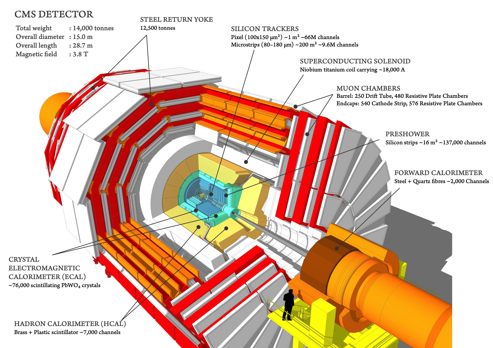

# UA CMS: Hexaboard Visual Inspection

A deep learning-based visual inspection system for detecting defects in hexaboard segments from the High Granularity Calorimeter (HGCAL) detector of the CMS experiment at CERN.

## Description

The High Granularity Calorimeter (HGCAL) is a key component of the CMS detector upgrade for the High Luminosity Large Hadron Collider (HL-LHC). HGCAL consists of silicon sensors arranged in hexagonal modules called hexaboards, which provide unprecedented spatial resolution for particle detection in the forward region of the CMS detector.


*Cutaway diagram of CMS detector (retrieved from <https://cds.cern.ch/record/2665537/files/>)*

Hexaboards are critical silicon sensor modules that form the active detection layers of the HGCAL endcap calorimeter. These hexagonal-shaped boards contain arrays of silicon pad sensors that measure the energy deposits from electromagnetic and hadronic showers. Each hexaboard must meet strict quality standards, as defects can significantly impact the detector's performance in measuring particle energies and positions with high precision.

This project implements an automated visual inspection system that combines:

- **Autoencoder-based anomaly detection**: A convolutional autoencoder trained on reference images to detect reconstruction anomalies
- **Pixel-wise comparison**: Traditional image comparison using Structural Similarity Index Measure (SSIM) between baseline and test images
- **Method-specific flags**: Pixel and autoencoder flags are shown separately; hybrid flags indicate their intersection

## Setup

The current environment was validated with Python 3.12.3, PyTorch 2.13.0,
TorchVision 0.28.0, and NumPy 1.26.4. Use a compatible CPU or CUDA PyTorch build.

```bash
python -m venv venv
source venv/bin/activate
python -m pip install -r requirements.txt
```

Run module commands from repository root. Activate the environment before
starting the server so its inspection subprocess uses the same interpreter.
The frontend is plain HTML/CSS/JavaScript served by Python; no Node build is needed.

## Calibrate and start inspection

Edit `configs/inspection.yaml` to select the checkpoint, baseline, calibration
folders, labels, and device. The current saved `run_01.pt` uses 64 latent channels,
128 initial filters, and `[2, 2, 2]` blocks. The training YAML is a separate
experiment configuration. Set `inspection.model: {}` to infer CNN dimensions
from another checkpoint, or explicitly set matching architecture constraints.

```bash
# Generate new thresholds and their provenance manifest.
python -m scripts.calibrate --config-path configs/inspection.yaml

# Start the UI at http://127.0.0.1:3000.
python -m scripts.server --config-path configs/inspection.yaml
```

Open the page, enter a processed board path inside the configured `data_root`,
and choose **Load Board** or **Run Inspection**. Loading a board computes an
inspection if no current result exists. Run Inspection forces a fresh run via
`jobs/main.sh` on POSIX, using the server's Python and YAML. Windows uses the
same inspection CLI directly.

The shared Python entry points are:

```python
from src.configs.inspection_config import InspectionConfig
from src.inspection.calibration import calibrate
from web.server import run_server

config = InspectionConfig.from_yaml('configs/inspection.yaml')
calibrate(config)
run_server(config=config)
```

For a single inspection without the browser:

```bash
python -m scripts.inspect --config-path configs/inspection.yaml \
    --new-hexaboard-path data/bad_example/320XLF4CQH00445.npy
```

The server and command save `<board>.inspection.json` beside each processed
`.npy` file. It contains `pw_flags`, `ae_flags`, `hybrid_flags`, board metadata,
and source signatures. Status values are `-1` skipped, `0` OK, and `1` flagged.
Results are reused only while the board, baseline, checkpoint, thresholds, mask,
and model settings match. Changing the baseline, weights, or mask requires
recalibration. Existing threshold files without `manifest.json` must be regenerated.

Calibration, inspection, analysis, and reconstruction evaluation now take one
`--config-path`; their former separate model/path arguments have been replaced
by the shared YAML. Training retains its training configuration and data arguments.

## Data and calibration contract

Stored boards must be BGR `uint8` tensors shaped `(8, 5, 1060, 1882, 3)`.
Production loading checks the full shape and dtype. Segment extraction converts
to RGB and normalizes to `[0, 1]`. Dataset loading accepts a single file or a
directory, validates all boards, and memory-maps each board instead of copying
it for every segment. Smaller fixtures must explicitly supply their shape.

The canonical `calibrations/skipped_segments.json` defines eight skipped corners,
leaving 32 inspected positions. Grid coordinates are zero-based and traverse
rows first. The image tensor remains on the server; the UI requests one PNG
segment at a time.

The UI minimap reverses both board axes, matching notebook 04: source `(row, col)`
appears at display `(7 - row, 4 - col)`. This rotates the segment arrangement
180 degrees without rotating individual images. Navigation follows display order;
labels, flags, image requests, and the displayed segment numbers retain source
coordinates (segment numbers in the UI are one-based).

Calibration scores each normal board/coordinate once and uses labeled anomalous
segments from a deterministic subset of `bad_dir`. Defaults use `data/train`
and `data/val` for normal calibration and half the annotated bad boards, selected
with seed 42. `data/test` and remaining bad board identities are held out for
analysis. Keep board identities unique across acquisition splits.

- Pixel score: `1 - SSIM(reference, inspected)`.
- Autoencoder score: `MAE(sigmoid(model(inspected)), inspected)`.
- Flagging: score greater than or equal to the position's threshold.
- Hybrid: intersection of the two methods.
- Positions with both normal and defect examples use F1 threshold selection.
- Positions without defect examples use the configured normal-score quantile,
  nudged upward so an equal normal score is not flagged. This fallback still
  needs enough normal boards to estimate a useful operating point.

Threshold arrays and a provenance manifest are written to `calibration_dir`.
Do not use calibration performance as held-out model quality. Low reconstruction
loss alone does not establish defect-detection accuracy.

## Evaluate and analyze

```bash
# Confusion matrices over all unmasked positions on held-out boards.
python -m scripts.analyze --config-path configs/inspection.yaml

# Limit each evaluation class for an integration check.
python -m scripts.analyze --config-path configs/inspection.yaml --max-boards 1

# Reconstruction loss and an example image, without retaining every image in RAM.
python -m scripts.evaluate --config-path configs/inspection.yaml --display-segment-idx 0
```

Reports and plots go to the configured `output_dir`, normally `outputs/inspection`.
Analysis excludes calibration board IDs and the reference board, including copies
in different directories. Its label contract treats unmarked positions as normal;
complete damage labeling is therefore necessary for meaningful metrics.

## Training

```bash
python -m scripts.train --config-path configs/train_CNNAutoencoder.yaml \
    --train-data-dir data/train --val-data-dir data/val
```

Use `--checkpoint-path` for a resumable trainer checkpoint. Missing/incompatible
checkpoints fail instead of silently starting another run. Autoencoder training
uses a tensor as both input and reconstruction target; the generic trainer keeps
its supervised pair interface. Both share scheduling, validation, callbacks,
checkpointing, distributed reductions, and graceful interruption.

Set `scheduler_interval` to `optimizer_step`, `epoch`, or `validation` explicitly.
The training YAML uses `epoch`; `ReduceLROnPlateau` requires `validation`.
With step-based validation, the pasted base trainer also validates at each epoch
boundary when that boundary was not already evaluated. The first Ctrl-C finishes
an update and saves resumable state; a second forces interruption.

Logs, weights, checkpoints, and resolved run metadata go under `logs/`.
Figures go under `outputs/`. Exact shuffled mid-epoch resume determinism and
multi-GPU behavior still require separate validation. Do not start a long run
until the data, calibration, and short training checks pass on the target device.

## Server API

| Endpoint | Purpose |
| --- | --- |
| `GET /api/config` | Configured initial board path |
| `GET /api/board?path=...` | Shape, labels, skips, and inspection grids |
| `GET /api/segment?path=...&row=...&col=...` | One RGB segment as base64 PNG |
| `POST /api/label` | Persist `{path, row, col, damaged}` |
| `POST /api/run` | Force inspection for `{path}` |

Only `.npy` boards inside `data_root` are accepted. Labels and segment coordinates
are bounds-checked. The supported operational input is a preprocessed board;
scanner acquisition and cropping remain hardware integration work under `scanner/`.

## Tests and conventions

```bash
PYTHONPATH=. python -m pytest -q
python -m pip install -r requirements-dev.txt
ruff check src scripts web tests scanner
```

Full-resolution CNN/ResNet tests exercise shape and gradient behavior. Trainer,
loader, threshold, serialization, and HTTP tests use synthetic fixtures and
temporary artifacts. Notebooks are clients of repository helpers; editing them
does not require executing training cells.

Follow `AGENTS.md` for quote choice, type annotations, grouped imports, NumPy
API docstrings, and multiline layouts. Plot helpers accept `savefig` and `show`;
`show=False` returns the figure for the caller to close. `save_fig` remains a
compatibility alias. CLI modules are execution-only and are never imported by
application code.
